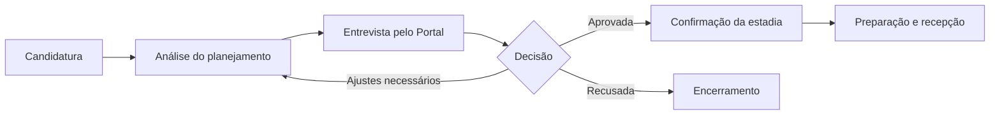

# Casa do Oleiro

**Uma plataforma para organizar a jornada de voluntariado — da candidatura ao planejamento da estadia.**

O Casa do Oleiro é uma aplicação web criada para apoiar a operação de uma comunidade que recebe voluntários. O produto conecta o acompanhamento das candidaturas, a análise dos planejamentos, a comunicação de ajustes e a organização da ocupação em um fluxo único.

> Este repositório documenta um projeto real em evolução. Não são publicados dados pessoais de voluntários nem credenciais de acesso.

## O problema

A gestão de voluntários envolve várias etapas e pessoas: receber candidaturas, avaliar propostas de atividades, acompanhar prazos, alinhar mudanças e prever a ocupação. Quando essas informações ficam dispersas, aumenta o esforço de coordenação e fica mais difícil entender qual é a próxima ação necessária.

## A solução

O produto é dividido em duas experiências conectadas:

- **Portal do voluntário:** acompanhar a candidatura, preparar o planejamento de atividades e responder a solicitações de ajuste.
- **Área administrativa:** analisar candidaturas, acompanhar pendências, revisar planejamentos e consultar agenda e ocupação.

### Fluxo principal



## Funcionalidades em destaque

- Gestão de candidaturas individuais e em casal.
- Planejamento de atividades e sessões por data.
- Revisão de propostas e acompanhamento de ajustes.
- Indicadores de atenção para pendências do voluntário e da administração.
- Agenda e visão mensal de ocupação.
- Separação de acesso por perfil e unidade operacional.
- Interface responsiva e suporte a diferentes idiomas.

## Validação em contexto real

O sistema foi desenvolvido como projeto de extensão acadêmica para a Comunidade Terapêutica Casa do Oleiro, com participação do acadêmico, da coordenação e da psicóloga na validação dos fluxos. O relatório do projeto registra também o primeiro uso operacional por um voluntário real da instituição.

### Resultados iniciais relatados

- Informações de candidatura, planejamento e estadia passaram a ser registradas em um ambiente centralizado, em vez de depender exclusivamente de conversas e memória individual.
- A equipe passou a consultar candidaturas, agenda e ocupação por unidade em um fluxo comum.
- A psicóloga envolvida estimou que determinadas rotinas administrativas, antes próximas de quatro horas por dia, passaram a demandar menos de uma hora em determinados dias.

> **Como interpretar esse resultado:** a estimativa de tempo foi relatada pela equipe e não corresponde a uma medição científica ou a uma série histórica. O impacto ainda precisa ser acompanhado com métricas consistentes ao longo do tempo.

O projeto se relaciona ao **ODS 3 — Saúde e Bem-Estar** de forma indireta: seu papel é fortalecer a organização do programa de voluntariado, não realizar atendimento clínico nem substituir a atuação terapêutica da instituição.

## Decisões de produto e engenharia

**Uma candidatura compartilhada para casais.** Cada participante mantém seu próprio usuário e perfil, enquanto os dois podem colaborar no mesmo planejamento. A desistência de uma pessoa não precisa apagar a candidatura da outra.

**Consultas limitadas ao contexto necessário.** Listagens usam paginação; agendas consultam intervalos de datas; detalhes são carregados quando necessários. Resumos controlados na candidatura evitam leituras adicionais de perfis para montar cada item de lista.

**Separação entre interface e serviços.** As experiências de Portal e Administração têm módulos próprios, com serviços compartilhados para regras e operações comuns. O build consolida arquivos para reduzir requisições sem misturar indiscriminadamente os módulos-fonte.

**Publicação com validações.** O pipeline verifica integridade de assets, sintaxe, contratos de dados e artefato de produção. Os testes de navegador usam emuladores do Firebase; eles complementam, mas não substituem, a validação final com permissões e contas reais.

**Proteção de dados e releases.** Dados pessoais de produção não devem ser usados como massa de teste. Configurações são injetadas no deploy, e alterações de interface não devem publicar automaticamente mudanças de regras, índices ou dados.

## Arquitetura em alto nível

```text
Pessoa voluntária                  Equipe administrativa
       |                                     |
       v                                     v
  Portal web                            Admin web
       |                                     |
       +----------- serviços ---------------+
                         |
             Firebase Authentication
                         |
                  Cloud Firestore

Repositório GitHub
       |
       v
GitHub Actions -> validações -> build -> GitHub Pages
```

O frontend é uma aplicação web estática publicada pelo GitHub Pages. O Firebase fornece autenticação e persistência com Cloud Firestore. A configuração do cliente e do monitoramento é injetada no pipeline de publicação.

## Tecnologias

- **Frontend:** HTML, CSS e JavaScript
- **Dados e autenticação:** Firebase Authentication e Cloud Firestore
- **Automação:** GitHub Actions
- **Testes:** Node.js, Playwright e emuladores do Firebase
- **Observabilidade:** Sentry (monitoramento de erros e diagnóstico de performance)\n- **Publicação:** GitHub Pages

## Qualidade e validação

Os workflows automatizam verificações como:

- testes de integridade dos assets;
- validação de sintaxe JavaScript e configuração JSON;
- verificação do artefato para impedir a publicação de arquivos de desenvolvimento e regras internas;
- testes de regressão em navegadores Chromium e WebKit;
- conferência de contratos de dados e arquitetura.

Para executar a suíte E2E localmente, com Node.js instalado:

```bash
npm install --no-audit --no-fund
npx playwright install chromium webkit
npm run test:e2e:emulated
```

## Meu papel no projeto

Atuação na concepção do produto, estruturação dos fluxos, priorização de melhorias, revisão de arquitetura e evolução da aplicação com desenvolvimento assistido por IA. O foco é combinar velocidade de entrega com legibilidade, testes e critérios de publicação seguros.

## Documentação técnica

- [Backend e modelo de dados](BACKEND.md)
- [Configuração do Firebase](FIREBASE_SETUP.md)
- [Auditoria de arquitetura — setembro de 2026](docs/architecture-audit-20260918.md)
- [Workflows de CI/CD](.github/workflows/)

## Repositório

[Ver código-fonte e histórico de desenvolvimento](https://github.com/FernandeLuan/CasaDoOleiro)
